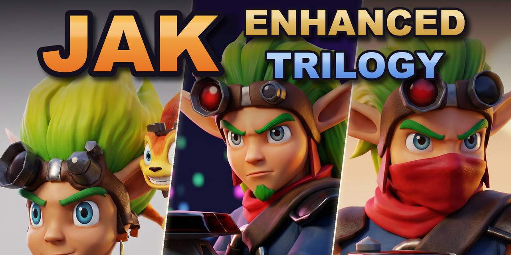

# Jak Enhanced Trilogy

A remaster of the **Jak and Daxter trilogy** for PC (Windows), built on [OpenGOAL](https://opengoal.dev):
modern lighting, living weather, reflections, denser vegetation and cities, a modern minimap, optional
HD textures, and an in-game menu that turns every change on and off.

Unofficial and free. You need **your own disc images** (.iso) of the PS2 games: no game data is in
this repository.

## Install (players)

1. Download **`Setup-Jak-Enhanced-Trilogy-<version>.exe`** from the
   [Releases page](https://github.com/stichlola/jak-enhanced-trilogy/releases/latest) and run it.
2. Pick where to install, your disc images (PAL, NTSC or NTSC-J; one, two or all three games) and
   whether to make the **HD textures** for each game.
3. Play from the desktop or Start menu shortcut.

The first start of each game extracts your disc (20-40 minutes, once). The HD textures are every
texture redrawn 4x by an AI on your graphics card, from your own disc: about 30 minutes for Jak 1,
1-2 hours for Jak II or Jak 3, 1-4 GB; optional, the game works the same without them (skipped
ones are asked again at the next start). About 30 GB free a game. To update, run the new setup
over the old install: extracted discs and saves stay.

No installer? The release also has a ZIP: unzip it, put your .iso files in `ISO`, double-click
`Jak Enhanced Trilogy.bat`.

## Install (developers)

1. `git clone https://github.com/stichlola/jak-enhanced-trilogy.git`
2. Put your disc images in `ISO` and double-click `Jak Enhanced Trilogy.bat`: it installs what's
   missing with winget (VS 2022 Build Tools with Clang, CMake, NASM), builds (about an hour the first
   time), extracts and plays. Or from PowerShell: `scripts\enhanced\setup.ps1 -Jak3Iso <iso>`
   (`-SkipBuild`, `-HdTextures`...).
3. After a change: `cmake --build out\build\Release` (C++),
   `out\build\Release\bin\goalc.exe --user-auto --game jak3 --cmd "(mi)"` (game code; `jak1`, `jak2`).

Where things are: graphics in `game/graphics/opengl_renderer/EnhancedPost.cpp` and
`game/graphics/opengl/shaders/enh_*`; game code (GOAL) in `goal_src/jak1|jak2|jak3`, changes marked
`Enhanced`; zones, grades, weather and ambient sounds in `game/assets/enhanced/world.json`.
Technical notes in [ENHANCED.md](ENHANCED.md), rules for contributions in
[CONTRIBUTING](.github/CONTRIBUTING.md) (no game data, everything can be switched off).

## To do

- **Pause map**: the big map restyled like the minimap's district maps; a modern minimap frame.
- **New art made with Tripo** (original, so it lives in this repository):
  - icons: the pause map's icons, Jak 1 and Enhanced-menu icons (weather, time of day, presets);
  - painted maps: the Jak 3 and Jak II pause maps redrawn, the minimap frame;
  - tileable PBR materials (color, normal, height, roughness): puddle and rain ripples, wet asphalt,
    snow, sand ripples, mud for footprints and tire ruts, close-up detail for rock, grass and sand;
  - later, models: grass clumps, flowers, bushes and city clutter for the denser vegetation and
    cities, new passers-by.
- Later: the continuous trilogy (bridge levels, one save), life in the Jak II plaza, Linux / Steam
  Deck, hardware ray tracing. Details in [ENHANCED.md](ENHANCED.md).

## Controls

| | Keyboard | Pad |
|---|---|---|
| Enhanced menu | **F1** or **`\`** | **Select + R3** (Xbox: View + RS) |
| Nap: the hours go by while the world around runs fast | **N** | **Select** (Xbox: View) |
| Start menu (opens with the game played last, when more than one is set up): pick a game | **Left / Right**, **Enter**; **C** continues from its newest save | **D-pad**, **A**; **Y** continues |
| Next game of the trilogy | **F9** (rebind it in the menu's Controls) | |
| Something wrong? | `Report a problem.bat`: logs, graphics card and settings in a ZIP on your Desktop | |
| Photo mode | **F3** (F2 takes the picture) | |

The button pictures and names in the games are an Xbox pad's (A B X Y, LB RB LT RT, Menu).

## What's new

- **Graphics**: sun shadows, ambient occlusion, indirect light; lamps, fires and shots that light
  their surroundings; volumetric clouds, light shafts, mist; reflections and wet streets; color grade
  per area; more grass and plants that bend; footprints and tire ruts.
- **Weather**: fair, clouds, rain, storms, fog, snow, sandstorms, different on every visit; puddles
  that fill and dry; ambient sounds (rain, wind, crickets, birds, frogs, the sea, the city).
- **Gameplay**: nap through the hours while the world runs fast; F9 to the next game of the trilogy (each resumes its newest save); photo mode; city population from Low to Extreme; Jak II and 3 tweaks
  (ammo, guns, jetboard).
- **HUD**: a smaller, modern minimap with redrawn icons and maps; subtitle size.
- **Menu**: presets (Classic, Performance, Medium, Maximum), a switch for every effect, weather, time
  of day, field of view. Choices are saved.

## Credits

- **Jak Enhanced Trilogy** by [stichlola](https://github.com/stichlola), made with
  [Claude Code](https://claude.com/claude-code). If you make a video, a mod or a fork from it, please
  credit "Jak Enhanced Trilogy by stichlola" with a link to this repository.
- **[OpenGOAL](https://opengoal.dev)** and its team, everything here is built on their work. Not
  affiliated with them: please don't report Enhanced bugs to them.
- **Naughty Dog**, for the trilogy; **Ratchet & Clank Enhanced**, the inspiration.
- [Real-ESRGAN](https://github.com/xinntao/Real-ESRGAN) (HD textures), [Dear ImGui](https://github.com/ocornut/imgui)
  (menu), [Tripo](https://www.tripo3d.ai) (minimap icons, desert sand), [ElevenLabs](https://elevenlabs.io)
  (ambient sounds).

## Legal

Use your own legally owned copies of the games. Jak and Daxter: The Precursor Legacy, Jak II and
Jak 3 are © Sony Interactive Entertainment / Naughty Dog. This project is unofficial and contains no
game assets; the HD textures are made on your computer from your discs. OpenGOAL's license applies
to the code ([LICENSE](LICENSE)).

**No donations of any kind are accepted for this project.** It is free and stays free.
